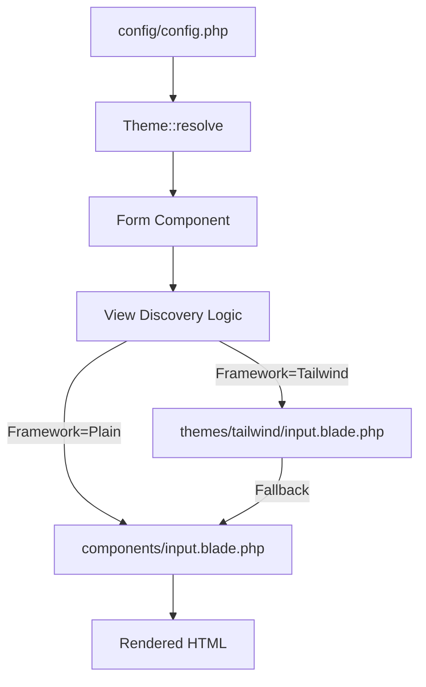

# Requirements

### Overview & Goals
The goal is to transform `laravel-form-components` into a framework-agnostic package that supports multiple frontend CSS frameworks while maintaining a clean, semantic "plain" version as the default. This will allow developers to use the package regardless of their choice of CSS framework (Tailwind, Bootstrap, Bulma, etc.) and provide an easy path for custom styling.

### Scope
- **In Scope**:
    - Implementing a new `plain` theme with semantic classes as the default.
    - Adding support for Tailwind CSS, DaisyUI, and Bulma.
    - Preparing for Bootstrap 6.
    - Implementing a theme-specific view discovery system.
    - Removing hardcoded framework assumptions from all Blade components.
- **Out of Scope**:
    - Adding support for JS-heavy frameworks like React or Vue (this remains a Blade-focused package).
    - Designing a custom CSS file for the "plain" theme (semantic classes only).

### User Stories
- **As a developer**, I want to use `laravel-form-components` with Tailwind CSS without having to manually override every Bootstrap class.
- **As a designer**, I want a "plain" version of the components with stable semantic classes so I can write my own CSS from scratch.
- **As a package maintainer**, I want to support new frameworks like Bootstrap 6 by simply adding a configuration entry and optional template overrides.

### Functional Requirements
- The package must default to the `plain` theme if no framework is specified.
- Components must automatically detect and use theme-specific templates (e.g., `input.tailwind.blade.php`) if they exist.
- All CSS classes and structural flags (wrappers, labels) must be driven by the theme configuration.
- The `plain` theme must provide semantic classes like `mfc-field`, `mfc-input`, and `mfc-error` to allow easy CSS targeting.

# Technical Design

### Current Implementation
The package currently uses a simple `Theme::resolve` helper that looks up classes in `config/form-components.php`. The framework is hardcoded to `bootstrap-5` by default, and many Blade templates contain hardcoded Bootstrap classes (e.g., `form-group`, `is-invalid`).

### Key Decisions
1. **Semantic Plain Theme**: Instead of truly "vanilla" (no classes), the `plain` theme will provide semantic classes (`mfc-*`) to provide a stable hook for custom styling while remaining visually minimal.
2. **Theme-Specific Templates**: To avoid bloated Blade files with excessive `@if` statements, we will use a prioritized discovery pattern for views: `themes/{framework}/{component}` -> `{component}`.
3. **Configuration-Driven Structure**: Structural decisions (like whether to use a wrapper `div` or where to place the label) will be moved into the theme configuration flags.

### Proposed Changes
- **Core Engine**:
    - Enhance `Theme::resolve` to support nested lookups and fallback defaults.
    - Update `FormBaseComponent` to handle dynamic view path resolution based on the active framework.
- **Configuration**:
    - Add `plain`, `tailwind`, `daisyui`, `bulma`, and `bootstrap-6` definitions.
- **Component Refactoring**:
    - Systematically replace all hardcoded strings in `.blade.php` files with `theme_class()` calls.
    - Create `resources/views/themes/bootstrap-5/` and move current Bootstrap-specific logic there for components that need unique structures.

### File Structure
- `src/Theme/Theme.php` (Modified: Enhanced resolution logic)
- `src/View/FormBaseComponent.php` (Modified: Theme-aware `render` method)
- `config/config.php` (Modified: New themes and `plain` default)
- `resources/views/themes/` (New: Framework-specific templates)
    - `tailwind/`
    - `bootstrap-5/`
    - `bulma/`
    - `plain/`
- `resources/views/components/` (Modified: Cleaned of hardcoded classes)

### Architecture Diagram

# Testing

### Validation Approach
Verification will involve rendering components under different framework configurations and asserting that the correct CSS classes and HTML structures are applied.

### Key Scenarios
- **Plain Theme Rendering**: Verify that components render with `mfc-*` classes and no Bootstrap classes when `framework` is set to `plain`.
- **Tailwind Override**: Verify that when `framework` is set to `tailwind`, the component uses Tailwind utility classes and picks up theme-specific templates if available.
- **Bootstrap 5 Backwards Compatibility**: Ensure existing Bootstrap 5 implementations continue to work exactly as they do now.

### Test Changes
- **New Feature Tests**: Create a test suite that iterates through all supported frameworks and verifies a baseline set of components (Input, Select, Button) for each.
- **Structural Tests**: Verify that `use_group_wrapper` and `use_input_wrapper` flags are correctly respected for both Tailwind (typically `false`) and Bootstrap (typically `true`).

# Delivery Steps

### ✓ Step 1: Upgrade core theme engine and implement semantic plain default
Enhance the theme engine to support multiple frameworks and template discovery.
- Update `Mlbrgn\LaravelFormComponents\Theme\Theme` to support granular configuration lookups and metadata.
- Modify `Mlbrgn\LaravelFormComponents\View\FormBaseComponent` to implement theme-specific view discovery (checking `themes/{framework}/{component}` before falling back to default).
- Update the package service provider to register the new `themes` view directory.
- Implement the `plain` theme as the new default in `config/config.php` using semantic classes (e.g., `mfc-field`, `mfc-input`).

### ✓ Step 2: Implement Tailwind CSS and DaisyUI support
Add configuration and specialized templates for Tailwind CSS and DaisyUI.
- Add `tailwind` and `daisyui` definitions to `config/config.php` with appropriate utility classes.
- Create theme-specific Blade templates for components that require Tailwind-specific structures (e.g., specific wrapper nesting for focus rings or DaisyUI component classes).
- Ensure structural flags like `use_group_wrapper` are correctly tuned for utility-first frameworks.

### ✓ Step 3: Refactor components for full theme agnosticism
Migrate all existing components to be fully theme-agnostic.
- Audit all components (Input, Select, Textarea, Radio, Checkbox, etc.) to replace hardcoded Bootstrap classes with `theme_class()` calls.
- Refactor `layout.form-group` and `layout.form-input-wrapper` to support theme-specific structural overrides.
- Move Bootstrap 5 specific logic into its own theme-specific templates to clean up the default views.

### ✓ Step 4: Add Bulma and Bootstrap 6 support
Expand support to Bulma and prepare the groundwork for future Bootstrap versions.
- Add `bulma` theme definition to `config/config.php`.
- Add a `bootstrap-6` (or `bootstrap-next`) placeholder definition to allow early adoption and testing of the next major Bootstrap release.
- Verify component rendering across all supported frameworks using the existing preview UI.

### ✓ Step 5: Validate multi-framework support and update tests
Ensure all existing and new theme features are verified.
- Update `ThemeLayoutTest` and `Bootstrap5Test` to cover the new multi-theme discovery logic.
- Add new feature tests for `Plain`, `Tailwind`, and `Bulma` rendering.
- Update the Preview UI to allow switching between different frameworks in real-time (if supported by the preview infrastructure).